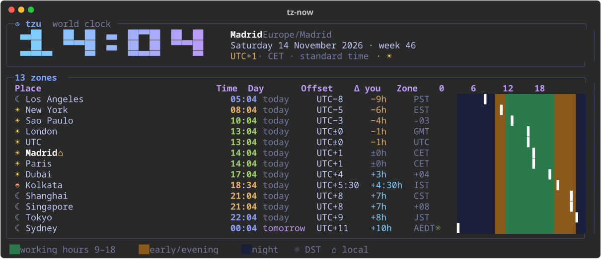

# jbang-catalog

JBang catalog for `llyorshch`.

## mvnrun

Runs standalone Maven plugin goals without installing Maven.

```bash
jbang mvnrun@llyorshch help:evaluate -Dexpression=java.version -q -DforceStdout
jbang mvnrun@llyorshch org.apache.maven.plugins:maven-dependency-plugin:3.8.1:get -Dartifact=org.slf4j:slf4j-api:2.0.13
jbang mvnrun@llyorshch --maven-version 3.9.15 help:help
```

On first use it downloads Maven from Maven Central, verifies its SHA-512 and caches it under
JBang's cache directory in `mvnrun/`. Set `MVNRUN_REPO_URL` to download Maven from another repository.

Goals that need a project, such as `compile`, need a `pom.xml` in the current directory.

## tzu: timezone utilities

Five colourful terminal tools for working across timezones. Each one is a JBang script
built with the [TamboUI](https://tamboui.dev) TUI library, and each can be exported to a
native executable. See [tzu/README.md](tzu/README.md) for screenshots and all options.

| Alias         | What it does                                                                     |
|---------------|----------------------------------------------------------------------------------|
| `tz-now`      | World clock: your time and a configurable group of timezones (`-w` live)         |
| `tz-meet`     | Meeting planner: a day's timetable across the group, best slots highlighted      |
| `tz-holidays` | Public holidays of the group's countries for a week, month, quarter or year      |
| `tz-find`     | Timezone of a city, country, abbreviation or UTC offset                          |
| `tz-map`      | World timezone map with day/night and the daylight saving time rules             |

```bash
jbang tz-now@llyorshch
jbang tz-meet@llyorshch fri --at 16:00
jbang tz-holidays@llyorshch 2026-Q4
jbang tz-find@llyorshch "san jose, costa rica"
jbang tz-map@llyorshch --mode dst

# install as commands (add --native for a GraalVM native executable)
for c in tz-now tz-meet tz-holidays tz-find tz-map; do jbang app install $c@llyorshch; done
```



## Tests

```bash
./test.sh "$PWD/mvnrun.java" /path/to/empty/work/dir
```

The work directory is deleted and recreated. Tests need network access, `curl` and `python3`.
