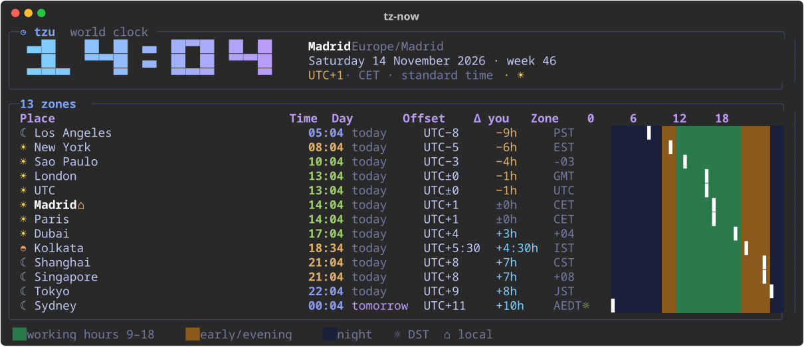
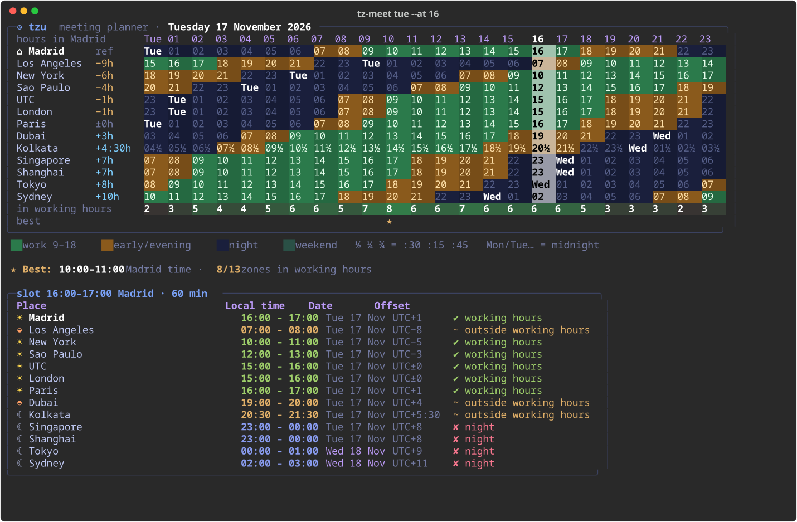
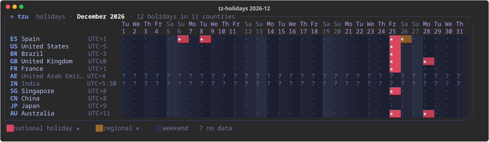
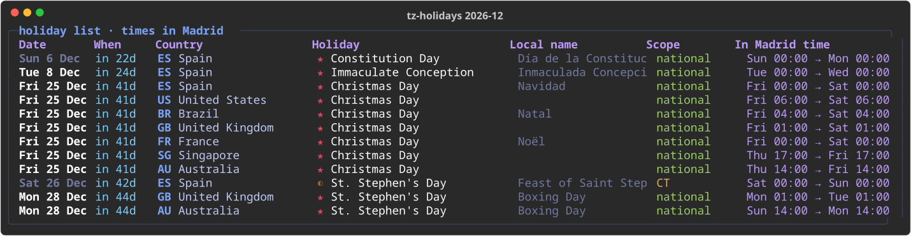
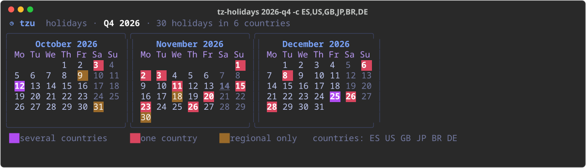
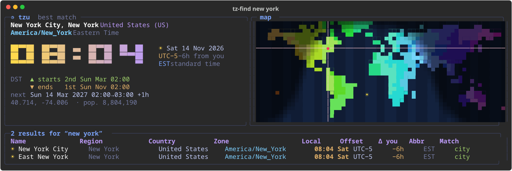
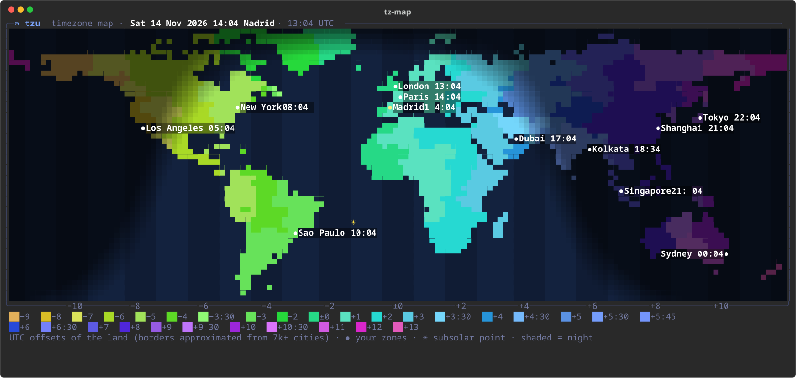
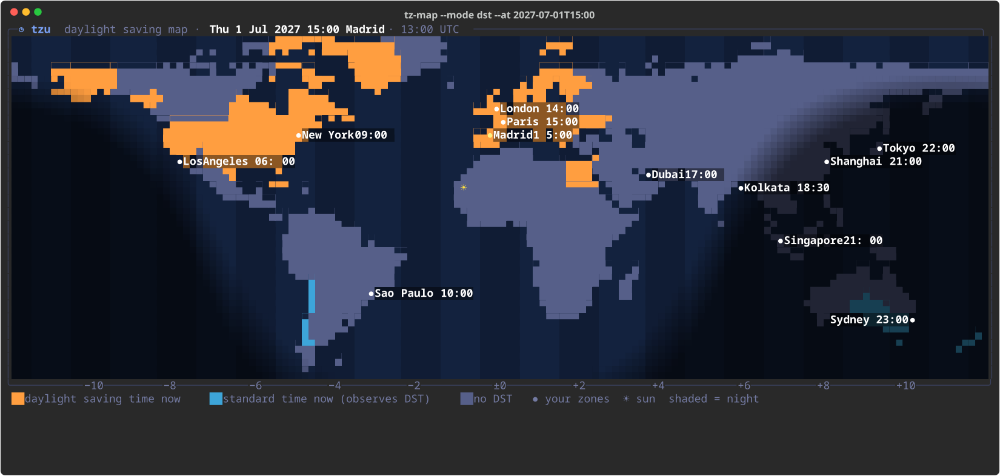
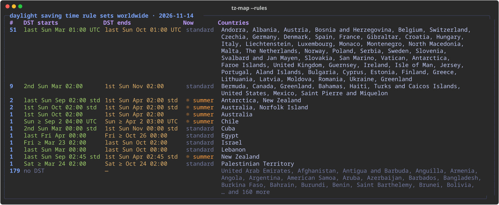

# tzu: timezone utilities for the terminal

Five small, colourful command-line tools for working across timezones. Each one is a
[JBang](https://www.jbang.dev) script. They share a small library and a config file, use the
[TamboUI](https://tamboui.dev) TUI library to draw, and each can be exported to a native executable.

| Command       | What it does                                                                        |
|---------------|-------------------------------------------------------------------------------------|
| `tz-now`      | World clock: your time and a configurable group of timezones (live mode with `-w`)  |
| `tz-meet`     | Meeting planner: a day's timetable across the group, with the best slots marked     |
| `tz-holidays` | Public holidays of the group's countries for a week, month, quarter or year         |
| `tz-find`     | Finds the timezone of a city, country, abbreviation (CET, IST…) or UTC offset       |
| `tz-map`      | World map of the timezones with day and night shown, plus the DST rules             |

## Run or install with JBang

The commands are published as aliases in the [`llyorshch/jmg-tools` JBang catalog](../jbang-catalog.json):

```bash
# run without installing
jbang tz-now@llyorshch/jmg-tools
jbang tz-meet@llyorshch/jmg-tools fri --at 16:00
jbang tz-find@llyorshch/jmg-tools "san jose, costa rica"

# install them as commands on your PATH
jbang app install tz-now@llyorshch/jmg-tools
jbang app install tz-meet@llyorshch/jmg-tools
jbang app install tz-holidays@llyorshch/jmg-tools
jbang app install tz-find@llyorshch/jmg-tools
jbang app install tz-map@llyorshch/jmg-tools

# or install a native executable (needs GraalVM, see below)
jbang app install --native tz-map@llyorshch/jmg-tools
```

You need Java 22 or newer. JBang downloads a JDK for you if none is installed.

## The commands

### `tz-now`: world clock



```bash
tz-now                          # configured zones; your local zone is always included (⌂)
tz-now -w                       # live, full-screen clock (q quits)
tz-now -z Tokyo,Lima,IST        # a one-off group of zones
tz-now --at "2026-12-24 18:00"  # times elsewhere when it is that local time
tz-now --add Bilbao --add "Mum=Mumbai" --remove UTC   # edit the configured group
tz-now --reset | --config       # restore the defaults / show the config file
```

The bar on the right shows each place's 24 hours, coloured by working hours, early or evening
hours, and night. A marker shows the current hour.

### `tz-meet`: meeting planner



```bash
tz-meet                          # today, configured zones, local time as the reference
tz-meet fri --at 16:00 -d 45     # next Friday; details for a 45-minute slot at 16:00
tz-meet 2026-12-03 -z "NYC=New York,Madrid,Tokyo" --work 8-17 -r "New York"
tz-meet -i                       # interactive: ←/→ hour, ↑/↓ day, b best slot, +/- length, t today
```

Each column is one hour in the reference zone. Each cell shows the local hour in that zone.
`½`, `¼` and `¾` mark offsets of :30, :15 and :45 minutes, and the weekday name marks
midnight. The `in working hours` row counts how many zones are in working hours, and `★`
marks the best slots.

### `tz-holidays`: holidays across countries





```bash
tz-holidays                       # this month, countries of the configured zones
tz-holidays -w                    # this week (or: W51, 2026-W51)
tz-holidays 2026-Q4 -c US,GB,DE,JP
tz-holidays 2027 --national       # a whole year, national holidays only
tz-holidays dec -r Tokyo          # show holiday start and end times in Tokyo time
```

The list shows when each holiday starts and ends in your timezone. For example, Christmas
in Sydney starts at 14:00 on the 24th Madrid time. Holiday data comes from
[Nager.Date](https://date.nager.at), which covers more than 200 countries, and is cached
for 30 days in `~/.cache/tzu` (`--offline` and `--refresh` control the cache).

### `tz-find`: find a timezone



```bash
tz-find tokyo
tz-find "springfield, us"         # city, country
tz-find Australia                 # every zone of a country
tz-find IST                       # abbreviations (ambiguous ones list every match)
tz-find +5:45                     # zones currently at that offset
tz-find Ponferrada --online       # any town, using the Open-Meteo geocoding API
tz-find Ushuaia --add             # add the best match to your zones
tz-find berlin --plain            # just "Europe/Berlin", for scripts
```

The embedded database has the 7,400+ largest cities from [GeoNames](https://www.geonames.org)
(population over 100k, plus capitals) and every country with its IANA zones. When nothing
matches, it searches online.

### `tz-map`: world map and DST rules





```bash
tz-map                            # map + DST rules of the configured zones
tz-map --mode dst                 # colour by DST status: in DST / standard time / no DST
tz-map --at 2027-07-01T12:00      # the world on another date (watch DST and the terminator move)
tz-map --rules                    # every DST rule set in the world and its countries
tz-map -i                         # interactive: ←/→ hours, ↑/↓ days, PgUp/PgDn months, m mode
```

The map is drawn with half-block characters, so each cell holds two pixels. Land is coloured
by the UTC offset of the nearest known city, which approximates the real timezone borders.
The night side is shaded using the computed position of the sun (`☀`).

## Configuration

All commands share `~/.config/tzu/config.properties` (or `$XDG_CONFIG_HOME/tzu`):

```properties
zones=America/Los_Angeles,America/New_York,Barcelona=Europe/Madrid,Asia/Tokyo
work.start=9
work.end=18
clock=24
```

The default group is Los Angeles, New York, São Paulo, UTC, London, Paris, Dubai, Kolkata,
Singapore, Shanghai, Tokyo and Sydney. Your local timezone is always added.

Environment variables:

- `TZU_LOCAL` overrides the local zone.
- `TZU_CONFIG` uses another config file.
- `TZU_WIDTH` forces the output width.
- `NO_COLOR` disables colours.
- `TZU_SVG=file.svg` saves the rendered output as SVG, which is how the screenshots here were made.

## Native executables

Every command can be compiled with GraalVM `native-image`. The native executables start in
a few milliseconds.

```bash
jbang export native -O tz-now TzNow.java     # one command
./build-native.sh                            # all of them, into ./build
jbang app install --native tz-now@llyorshch/jmg-tools  # install natively from the catalog
```

You need GraalVM 22+ (`JAVA_HOME` or `GRAALVM_HOME`) and a C toolchain (`gcc` on Linux,
Xcode CLT on macOS). Everything native-image needs is declared in the scripts:

- `//NATIVE_OPTIONS` in `lib/Term.java`, including FFM support for the Panama terminal backend.
- picocli's generated reflection config.
- `native/reachability-metadata.json`, which embeds the data files and the TamboUI key bindings.

The `tzu-native` GitHub workflow builds the five executables for Linux and macOS.

## Layout

```
TzNow.java TzMeet.java TzHolidays.java TzFind.java TzMap.java   one JBang script per command
lib/        shared code: Term (output + shared //DEPS), Config, Geo, Ui, WorldMap, Dst, Holidays, Net, Live, Dates
data/       cities.tsv, countries.tsv, landmask.txt (generated by tools/gen-data.py)
native/     native-image metadata
docs/       screenshots
```

## Data and credits

- [TamboUI](https://tamboui.dev) (MIT) draws the output and runs the full-screen modes.
- [picocli](https://picocli.info) parses the command-line options.
- [GeoNames](https://www.geonames.org) supplies the city and country data (CC BY 4.0).
- [IANA tz database](https://www.iana.org/time-zones) `zone.tab` maps zones to countries. The offsets and rules come from the JDK's tzdata.
- [Natural Earth](https://www.naturalearthdata.com) 1:50m land supplies the map's land mask (public domain).
- [Nager.Date](https://date.nager.at) supplies the public holidays. [Open-Meteo](https://open-meteo.com) does the online geocoding.
